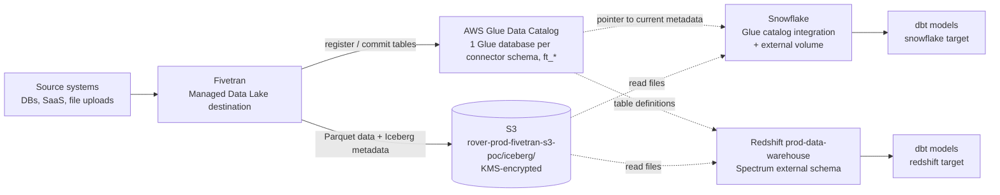
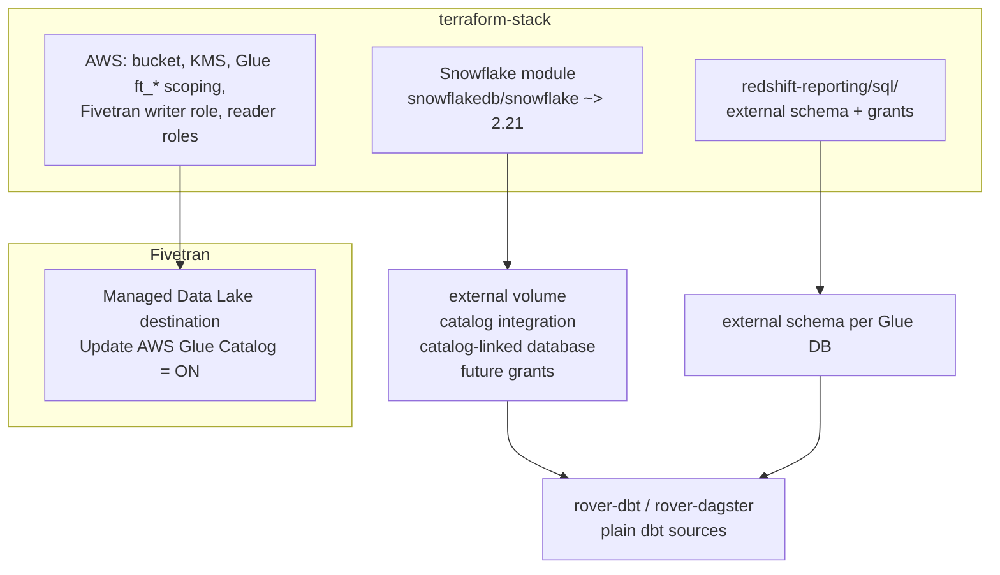

# Fivetran Managed Data Lake → Iceberg → Snowflake + Redshift

**Ticket:** DEV-157656 · **Status:** PoC working on both engines (2026-10-13) · **PoC repo:** [snowflake-poc-dbt#1](https://github.com/LaurenceWilliams/snowflake-poc-dbt/pull/1)

## TL;DR

Fivetran writes each connector's data **once**, as Apache Iceberg tables, to an S3 bucket we own, and registers every table in the AWS Glue Data Catalog. Snowflake and Redshift both read those same files through Glue. Nothing is copied between warehouses, and the data isn't tied to either engine.

**Recommendation (details in §7):** use it **selectively, for high-volume (high-MAR) connectors**, not as the default destination for every connector.



---

## 1. Why Iceberg (and why via Fivetran's Managed Data Lake)?

| Reason | Detail |
|---|---|
| **One copy, two engines** | During a Snowflake evaluation or migration, both warehouses need the same raw data. Two Fivetran destinations would mean two syncs, two sets of tables to keep consistent, and paying for both. One Iceberg copy is read by both engines. |
| **Not tied to an engine** | The data lives in our S3 in an open format (Parquet + Iceberg metadata). Whichever warehouse wins, the ingestion layer stays the same, and moving engines doesn't mean re-syncing everything. |
| **Real table semantics, not just files** | Iceberg handles transactional commits, snapshots, schema changes (columns added by Fivetran show up without any DDL) and row-level updates/deletes. Plain Parquet + Spectrum external tables give you none of that. |
| **Fivetran manages it** | Fivetran writes the files, commits the snapshots, keeps Glue up to date and expires old snapshots (one-week retention). We don't run Spark, compaction jobs or a catalog service. |
| **Glue as the catalog** | Both engines already support Glue natively (Snowflake's catalog integration, Redshift Spectrum). Glue is IAM-governed and lives in our AWS account. |

### Why a catalog at all? (learned the hard way)

The first destination (#10059) wrote Iceberg **without a catalog**. Snowflake's external table then read **every data file**, so it returned **every row version (duplicates) and deleted rows**. Iceberg's snapshot metadata is what says which files are current, and only a catalog-aware reader uses it. So the PoC moved to a **Managed Data Lake** destination with **Update AWS Glue Catalog = ON** (#10215). After that, row count and distinct primary-key count matched.

**Alternatives we didn't choose:**
- **Fivetran → Snowflake directly (plus keeping Fivetran → Redshift):** duplicate syncs, data held inside each engine, and parity drift between the two copies.
- **Plain Parquet, Hive external tables, or Iceberg read file-by-file without a catalog:** duplicates and deleted rows (see above), no transactional commits, manual schema management.

---

## 2. How it works

### 2.1 Storage and catalog (AWS, account `290268990387`, `us-west-2`)
- **Bucket:** `s3://rover-prod-fivetran-s3-poc/iceberg/<glue_database>/<table>/` (`data/` + `metadata/`), encrypted with KMS (required by `DataClassification=confidential`).
- **Glue:** Fivetran creates **one Glue database per connector schema**, named after it. Convention: every connector on this destination uses an `ft_` schema, so all IAM is scoped to `database/ft_*` and `table/ft_*/*`, and **new connectors need no Terraform change**. Each table has `table_type=ICEBERG` and `metadata_location` pointing to the current `*.metadata.json`; Fivetran moves the pointer on every sync.
- **Retention:** there's **no S3 expiry on the Iceberg data**. S3 lifecycle rules can't tell which files the current snapshot still uses, so Fivetran's snapshot retention (one week) handles cleanup. The 30-day expiry only applies to the legacy `fivetran/` prefix.
- **IAM roles** (`rover_roots/datastores/fivetran-s3-poc/prod/main.tf`):

  | Role | Who assumes it | Grants |
  |---|---|---|
  | `fivetran_s3_destination` | Fivetran (accounts `834469178297` / `341876425553`, external ID) | S3 write/delete/tagging, KMS, Glue catalog write on `ft_*` (plus the temporary `fivetran*` test database) |
  | `snowflake_read` | Snowflake IAM user, one external ID per object (external volume + catalog integration) | S3 read, `kms:Decrypt`, Glue `GetCatalog` + database/table read on `ft_*` |
  | `rover-prod-fivetran-s3-poc-spectrum` | Redshift `prod-data-warehouse` (attached via `cluster_iam_roles`) | S3 read, `kms:Decrypt`, Glue read on `ft_*` |

### 2.2 Snowflake
| Object | PoC name | Purpose |
|---|---|---|
| External volume | `ROVER_FIVETRAN_S3_POC_VOLUME` (`ALLOW_WRITES = false`) | S3 location + IAM trust used to read the data files |
| Catalog integration (Glue) | `ROVER_FIVETRAN_S3_POC_GLUE` | Reads table metadata through the Glue Iceberg REST endpoint (SigV4); `REFRESH_INTERVAL_SECONDS = 300` |
| Iceberg table | `FIVETRAN_S3_GLUE_POC.FT_DATA_PLATFORM_UPLOADS.TEST` → Glue `test_test` | Read-only pointer to the Glue table; `AUTO_REFRESH = TRUE` |

- **Refresh:** with `AUTO_REFRESH`, Snowflake checks Glue every 300s and moves to the newest snapshot. `ALTER ICEBERG TABLE … REFRESH` does it immediately. New Fivetran columns appear after a refresh (verified).
- **Setup in the PoC:** `dbt run-operation setup_iceberg_sources` runs `CREATE OR REPLACE ICEBERG TABLE … COPY GRANTS` for each source table.
- **Checks:** `SYSTEM$VERIFY_EXTERNAL_VOLUME(...)` and `SYSTEM$VERIFY_CATALOG_INTEGRATION(...)` must both succeed. The second needs `glue:GetCatalog` (#10255).

### 2.3 Redshift
- **Must be the main cluster (`prod-data-warehouse`).** Serverless's Spectrum policy can see Glue (`Resource "*"`), but its S3 allow-list doesn't include the Fivetran bucket and it has no `kms:Decrypt`, so it can't read the data.
- **One external schema per Glue database.** Every Glue table in that database appears in it automatically. There's no per-table DDL and no refresh step: Redshift reads the current Iceberg metadata at query time.
  ```sql
  CREATE EXTERNAL SCHEMA ft_data_platform_uploads
  FROM DATA CATALOG DATABASE 'ft_data_platform_uploads'
  REGION 'us-west-2'
  IAM_ROLE 'arn:aws:iam::290268990387:role/rover-prod-fivetran-s3-poc-spectrum';
  ```
- Glue tables can **only** be exposed through an external schema; they can't go into an ordinary schema like `dbt_<user>`. dbt models (views) go into the normal target schema and read from the external schema.
- Creating an external schema needs `CREATE` on the database, so **an admin creates it** and grants `USAGE`.
- Views over external tables must be **late-binding** (`bind=False`).
- #10072 originally planned per-table external tables via `dbt-external-tables`. That plan was dropped: with Glue, the external schema is enough.

### 2.4 dbt
- **Columns are not defined in dbt.** The schema belongs to Fivetran (Iceberg metadata) and both engines read it from there. Column entries in the source yml would only be documentation and somewhere to attach tests.
- The PoC uses one source yml for both engines; the database, schema and table name switch by target type.

---

## 3. PRs merged to make this work

All in [roverdotcom/terraform-stack](https://github.com/roverdotcom/terraform-stack), root `rover_roots/datastores/fivetran-s3-poc/prod`, by LaurenceWilliams.

| Merged | PR | What it did | Why it was needed |
|---|---|---|---|
| 2026-09-21 | [#10059](https://github.com/roverdotcom/terraform-stack/pull/10059) AWS floor | Bucket `rover-prod-fivetran-s3-poc` + dedicated KMS key; `fivetran_s3_destination` write role (trusts Fivetran's AWS accounts, external ID); Snowflake read role and `spectrum` read role (S3 read + `kms:Decrypt`, Spectrum also Glue read) | Base infrastructure for Fivetran to write to S3 and both warehouses to read it |
| 2026-09-22 | [#10085](https://github.com/roverdotcom/terraform-stack/pull/10085) | `s3:DeleteObject` on the Fivetran write role, scoped to `${bucket_arn}/*` | Fivetran deletes its connection-test file and staged files; without it the connection test fails with a 403 |
| 2026-09-22 | [#10072](https://github.com/roverdotcom/terraform-stack/pull/10072) | Snowflake role trust for the (manually created) storage integration; attaches the `spectrum` role to `prod-data-warehouse` | Lets both warehouses assume their read roles. **This is why only the main cluster can read the bucket.** |
| 2026-10-08 | [#10215](https://github.com/roverdotcom/terraform-stack/pull/10215) | Glue catalog for a new **Managed Data Lake** destination: `GlueCatalogWrite` for Fivetran, `GlueCatalogRead` for Snowflake, Spectrum scoped to `ft_*`; trust moved to the new destination's external ID; 30-day expiry limited to the legacy `fivetran/` prefix | Without a catalog, Snowflake read every file, giving **duplicates and deleted rows**. The Glue toggle can't be changed on an existing destination, so a new destination was needed. Expiry removed because S3 lifecycle could delete files the current snapshot still uses. |
| 2026-10-08 | [#10219](https://github.com/roverdotcom/terraform-stack/pull/10219) | `snowflake_read` trust takes **lists** of external IDs and Snowflake IAM user ARNs (storage integration + external volume + catalog integration) | Each Snowflake object has its own external ID; the trust only had the old storage integration's ID, so `AssumeRole` failed |
| 2026-10-09 | [#10255](https://github.com/roverdotcom/terraform-stack/pull/10255) | Adds `glue:GetCatalog` to `snowflake_read`'s `GlueCatalogRead` statement | `SYSTEM$VERIFY_CATALOG_INTEGRATION` failed: the Glue Iceberg REST endpoint calls `GetCatalog` before looking up databases and tables |

Superseded: #10058. Snowflake objects (external volume, catalog integration, Iceberg tables) and the Redshift external schema were created **by hand** for the PoC; see §5 for the production version.

---

## 4. Decisions made (and why)

| # | Decision | Why |
|---|---|---|
| 1 | **Glue as the catalog** (not Snowflake-managed Iceberg or Polaris/Open Catalog) | Fivetran writes to it natively; Redshift Spectrum can only read Glue; it lives in our AWS account under IAM. Without a catalog, reads return duplicates and deleted rows. |
| 2 | **`ft_*` naming convention for Glue databases** | IAM scoped by wildcard, so new connectors need no Terraform change. |
| 3 | **No S3 lifecycle expiry on Iceberg data** | S3 can't tell which files are live; Fivetran's snapshot retention cleans up safely. |
| 4 | **Snowflake: `CREATE OR REPLACE … COPY GRANTS`** rather than create-once (PoC) | The table is only a pointer (no data is lost), so replacing it re-applies the settings from yml and re-points a broken table. COPY GRANTS isn't in the Glue-catalog docs, but **we verified it keeps grants** (`created_on` changed; a control run without it dropped the grant). |
| 5 | **Redshift: `IF NOT EXISTS` + check**, never drop/replace | The schema covers the whole Glue database, and dropping it loses its grants. The check (`svv_external_schemas`) catches an ordinary schema with the same name, or one pointing at the wrong Glue database. |
| 6 | **Redshift on the main cluster, not serverless** | Only the main cluster's role can read the bucket and decrypt it. Moving to serverless later needs the bucket + KMS added to its Spectrum policy. |
| 7 | **No columns in dbt sources; no system-column filters by default** | Fivetran owns the schema. System columns differ by connector: file-upload tables are keyed by `_line` and have **no** `_fivetran_deleted`. Check the real schema before filtering. |
| 8 | **The dbt macro is PoC-only** | Production uses Terraform (§5). Infrastructure shouldn't depend on someone remembering to run a `run-operation`. |

**Replace vs create-once (Snowflake), for reference:**
- Replace: ✅ settings always match yml, broken pointers fix themselves, grants kept (COPY GRANTS) · ❌ resets table history (streams go stale), probably drops masking policies/tags (untested), auto-refresh restarts.
- Create-once: ✅ keeps history, policies and streams · ❌ settings that can't be changed with ALTER (volume, catalog, namespace, catalog table name) drift silently from yml; a broken table stays broken.

---

## 5. Production design



### What needs to be done

**AWS (terraform-stack)**: most of this exists from §3. Production is mostly a copy without "poc" in the names.
- [ ] Production bucket + KMS key (drop "poc" from the name). Keep **no expiry on the Iceberg prefix**; abort-multipart only.
- [ ] Copy the three roles with the `ft_*` Glue scoping, the external-ID lists (#10219) and `glue:GetCatalog` (#10255).
- [ ] If the reporting workload moves to **Redshift serverless**: add the bucket + `kms:Decrypt` to `modules/redshift-serverless` (`redshift_spectrum_access`).

**Snowflake (terraform-stack Snowflake module)**: replaces the manual PoC setup.
- [ ] `snowflake_external_volume` (`allow_writes = false`).
- [ ] `snowflake_catalog_integration_iceberg_rest` (Glue Iceberg REST endpoint + SigV4). ⚠️ `sigv4_external_id` is **ForceNew**: changing it recreates the integration and generates a new external ID, which must then be added to the `snowflake_read` trust.
- [ ] **Catalog-linked database** via `snowflake_execute` (the provider's `snowflake_database` doesn't support linked catalogs). It discovers Glue tables automatically, which **replaces the per-table macro**.
- [ ] Future grants on the linked database and its schemas to the reader roles.
- [ ] Decide `REFRESH_INTERVAL_SECONDS` (300s now) against freshness SLAs.

**Redshift (terraform-stack `redshift-reporting/sql/`)**
- [ ] One `CREATE EXTERNAL SCHEMA` file per Glue database + `GRANT USAGE` to the dbt and reporting groups (follow `18_create_overture_maps_raw_schema.sql`).
- [ ] Schema naming convention that can't clash with existing schemas (e.g. `ext_ft_*`).

**dbt / Dagster (rover-dbt, rover-dagster)**
- [ ] Plain `sources:` pointing at the external schema (Redshift) or the linked database (Snowflake). No setup macro.
- [ ] Staging models with **explicit column lists** (not `select *`), `bind=False` on Redshift.
- [ ] Source tests (`unique`/`not_null` on the primary key, freshness on `_fivetran_synced`).
- [ ] Check that the permissions CI (DEV-152337, which checks sources) understands external schemas.

**Fivetran**
- [ ] Production Managed Data Lake destination with **Update AWS Glue Catalog = ON** (can't be changed after saving).
- [ ] Move selected connectors (§7) one at a time, using `ft_` schema names; check row counts and distinct primary keys against the existing destination before switching over.

---

## 6. Risks and open questions

| Risk | Impact | Mitigation |
|---|---|---|
| **Load on the main Redshift cluster** | The main cluster is the concurrency bottleneck that started the Snowflake evaluation, and Spectrum reads still use leader-node and cluster resources. | Benchmark Spectrum-on-Iceberg vs native tables; long term, move readers to serverless (needs IAM change) or Snowflake. |
| **Spectrum cost and performance** | Spectrum is billed per TB scanned; Iceberg on Spectrum may be slower than native tables. | Materialise hot staging models as tables; keep raw access on views. |
| **Merge-on-read / delete files in Spectrum** | If Fivetran writes Iceberg delete files and Spectrum doesn't apply them, Redshift shows rows that should be gone. | Compare row counts and distinct primary keys across engines on a connector with updates/deletes (not tested yet — the PoC table is a file upload). |
| **Freshness lag on Snowflake** | Up to `REFRESH_INTERVAL_SECONDS` (300s) behind Glue. | Lower the interval, or trigger `REFRESH` from Dagster after Fivetran syncs. |
| **Silent schema changes** | `select *` plus late-binding views hide dropped or renamed columns until query time. | Explicit column lists, source tests, alerts on schema-change events. |
| **One-week snapshot retention** | No time travel or rollback beyond a week; a reader stuck on an expired snapshot fails. | Accept for raw data, or raise Fivetran's retention if needed. |
| **Catalog setting is fixed per destination** | A wrong destination setting means a new destination, a new external ID, a trust change and re-syncs (as happened between #10059 and #10215). | Get the production destination right first time (Glue ON, `ft_` schemas). |
| **COPY GRANTS is undocumented for Glue tables** | Snowflake could change the behaviour. | Moot once on a catalog-linked database + future grants. |
| **Replace drops policies/tags (Snowflake)** | Masking policies on PII would be lost on re-run. | Catalog-linked database (no replace), or apply policies after setup. |
| **External ID churn** | Each new Snowflake object, or a ForceNew recreate, brings a new external ID; until it's in the trust, `AssumeRole` fails. | External IDs kept as a list (#10219); `prevent_destroy` on the integration; `SYSTEM$VERIFY_*` checks after each apply. |
| **IAM/KMS drift between engines** | One engine silently loses access (as serverless has today). | Manage both reader roles in one module; Datadog check on a sample query per engine. |
| **External schema creation needs admin** | Dev users can't self-serve. | Keep it in terraform-stack SQL files. |
| **Glue is a single point of failure** | Glue outage or throttling blocks both engines. | Accepted (AWS-managed); watch Glue API throttling. |

---

## 7. Recommendation: use it or not?

**Use it selectively, for high-volume (high-MAR) Fivetran connectors. Keep low-volume connectors on their current warehouse destination.**

### Why high-MAR connectors benefit most
- **Ingestion costs are paid once, not per warehouse.** Fivetran bills by Monthly Active Rows. Keeping a high-MAR connector in both Redshift and Snowflake through two destinations roughly doubles the most expensive line items; one lake copy avoids that. Managed Data Lake pricing may also be lower than warehouse destinations; check the current contract.
- **The load work leaves Redshift.** For a warehouse destination, Fivetran's merge/upsert loads run on our cluster, and the busiest connectors run the heaviest merges. With the lake, Fivetran does that work, which frees concurrency on the cluster that is already out of headroom.
- **Storage is cheapest where data is biggest.** S3 + Parquet costs less than warehouse storage, and the saving grows with volume.
- **Migration is easiest where it's otherwise hardest.** Re-syncing a huge connector into a new warehouse is slow and expensive; with the lake, a new engine just points at Glue.

### Why not for everything
- **Low-MAR connectors:** small cost saving, and each one adds an external schema, Spectrum or Snowflake refresh, and IAM surface.
- **Latency-sensitive or heavily queried tables on Redshift:** Spectrum is slower than native tables and adds a per-TB scan cost, and Snowflake can lag up to 300s. Native tables win for hot, frequently joined data unless staging models are materialised.
- **Tables that need governance on the raw layer** (masking policies, row-level security): easier on native warehouse tables today.

### Choosing which connectors go to the lake
| Criterion | Lake | Warehouse destination |
|---|---|---|
| MAR | High (top connectors by MAR) | Low |
| Needed by both Snowflake and Redshift | Yes | One engine only |
| Load contention on Redshift | Heavy merges | Light |
| Query pattern on raw tables | Read once by staging models | Hot, ad hoc, low-latency |

### Next steps before committing
1. **Pilot one high-MAR connector that has updates and deletes.** This settles the biggest open risk (whether Spectrum applies Iceberg delete files) and gives real numbers.
2. Measure: Fivetran cost per destination, Redshift load-query time removed, and Spectrum vs native query time for the staging models.
3. If the pilot holds up, build the §5 production Terraform and move the top MAR connectors one at a time.

---

## 8. Lessons from the PoC

- Iceberg without a catalog isn't enough: reading files directly returns duplicates and deleted rows.
- `bind=False` views mean `dbt run` passing on Redshift **proves nothing about the columns**. Query the model to check it.
- Check actual columns first (`aws glue get-table`, `svv_external_columns`, `DESC ICEBERG TABLE`) before filtering on Fivetran system columns.
- `IF NOT EXISTS` on Redshift schemas silently does nothing when an ordinary schema has the same name. Always check `svv_external_schemas`.
- A new Fivetran column not appearing in Snowflake straight away is usually the 300s refresh interval, not a failure.
- Every Snowflake object that touches AWS has its own external ID, and the Glue REST path needs `glue:GetCatalog`. Run `SYSTEM$VERIFY_*` after each change.

## 9. How to run the PoC

```bash
# Snowflake
uv run dbt run-operation setup_iceberg_sources --args '{source_name: ft_data_platform_uploads}' --profiles-dir . --target snowflake
uv run dbt run --select ft_data_platform_uploads__test --profiles-dir . --target snowflake

# Redshift (main cluster; tunnel first: ssh -N redshift-tunnel; external schema pre-created by an admin)
uv run dbt run-operation setup_iceberg_sources --args '{source_name: ft_data_platform_uploads}' --profiles-dir . --target redshift
uv run dbt run --select ft_data_platform_uploads__test --profiles-dir . --target redshift
```
